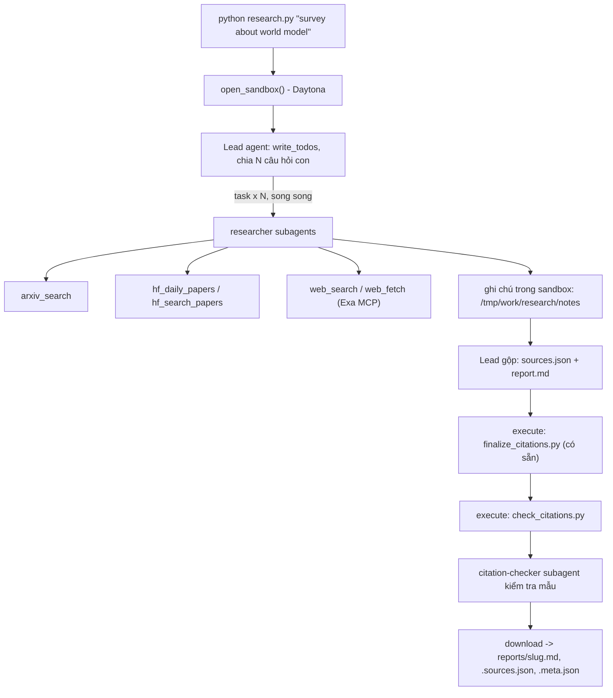

# Deep Research Agent (Deep Agents + Sandbox)

Lab dựng một **hệ thống deep research đa tác tử**: người dùng chỉ cần nhập một chủ đề (ví dụ `survey about world model`), hệ thống tự lập kế hoạch, giao việc cho nhiều subagent, tìm tài liệu trên arXiv, Hugging Face và web, rồi viết một **báo cáo có trích dẫn**.

Hình thức: **bài thực hành cá nhân**. Ngôn ngữ lập trình: Python 3.11 trở lên.

## 1. Mục tiêu học tập

Sau lab, bạn có thể:

1. Dựng agent bằng thư viện Deep Agents (LangChain): công cụ (tool), system prompt, subagent, backend.
2. Dùng **sandbox** (Daytona) làm không gian làm việc và nơi chạy mã cho agent; hiểu vì sao khóa API và công cụ mạng phải nằm ở phía host chứ không nằm trong sandbox.
3. Viết công cụ gọi API ngoài **chịu được giới hạn tốc độ** (retry, backoff, jitter, `Retry-After`).
4. Thiết kế quy trình đa tác tử: lead chia nhỏ câu hỏi, giao cho N researcher chạy song song, tổng hợp và kiểm tra trích dẫn.
5. Tạo báo cáo có thể kiểm chứng: mọi khẳng định có `[n]` trỏ tới một nguồn có thật.

## 2. Hệ thống làm gì



Nguồn dữ liệu:

| Nguồn | Dùng để |
|---|---|
| arXiv API `https://export.arxiv.org/api/query` | Tìm bài theo từ khóa, sắp theo ngày |
| Hugging Face Daily Papers `/api/daily_papers` | Bài đang "trending": upvotes, githubRepo, summary |
| Hugging Face papers search `/api/papers/search?q=` | Tìm bài theo chủ đề |
| Web qua Exa MCP (`web_search_exa`, `web_fetch_exa`) | Blog, survey, trang dự án, nội dung đầy đủ của một URL |

## 3. Cấu trúc thư mục

```
Lab/
├── README.md  GUIDE.md  RUBRIC.md  REPORT_TEMPLATE.md   tài liệu
├── topics.md                 5 chủ đề cần chạy
├── requirements.txt  .env.example  .gitignore
├── model.py                  CÓ SẴN - không sửa: tạo mô hình LLM từ biến môi trường
├── sandbox.py                CÓ SẴN - không sửa: sandbox Daytona (hoặc Docker), upload, download
├── self_check.py             CÓ SẴN - không sửa: tự kiểm tra trước khi nộp (python self_check.py)
├── finalize_citations.py     CÓ SẴN - không sửa: script chạy trong sandbox, tự sinh `## References` và đánh số lại trích dẫn
├── tools.py                  SINH VIÊN CÀI ĐẶT: retry + 5 công cụ nguồn dữ liệu
├── agents.py                 SINH VIÊN CÀI ĐẶT: prompt, subagent, lead agent
├── research.py               SINH VIÊN CÀI ĐẶT: script chính
├── check_citations.py        SINH VIÊN CÀI ĐẶT: kiểm tra trích dẫn, chạy TRONG sandbox
└── reports/                  báo cáo sinh ra (bạn commit vào repo nộp)
```

Mỗi tệp "SINH VIÊN CÀI ĐẶT" là **pseudo-code chạy được** (import được): các hàm có docstring mô tả việc cần làm, các `TODO n` đánh số theo `GUIDE.md`, thân hàm đang `raise NotImplementedError`.

## 4. Cài đặt

```bash
python3 -m venv .venv && source .venv/bin/activate      # Python 3.11+
pip install -r requirements.txt
cp .env.example .env                                     # rồi điền khóa CỦA BẠN
```

Bạn cần ba loại khóa (điền vào `.env`, **không bao giờ commit** `.env`):

| Khóa | Lấy ở đâu | Ghi chú |
|---|---|---|
| LLM (`LAB_MODEL` + khóa nhà cung cấp) | Nhà cung cấp bạn chọn (OpenAI, Anthropic, Google, OpenRouter, Ollama...) | Mô hình **phải hỗ trợ tool calling**. Chép tên mô hình từ tài liệu của nhà cung cấp. |
| `DAYTONA_API_KEY` | https://app.daytona.io | Kiểm tra gói miễn phí / credit hiện hành. Không có tài khoản hoặc hết credit: đặt `SANDBOX=docker` để chạy sandbox trong container Docker cục bộ (xem `.env.example`). |
| `EXA_API_KEY` (khuyến nghị) | https://dashboard.exa.ai/api-keys | Có thể chạy không khóa, nhưng bản miễn phí của MCP bị giới hạn tốc độ rất nhanh. |

## 5. Làm bài

Làm theo thứ tự (chi tiết trong `GUIDE.md`):

1. `check_citations.py`: khởi động nhẹ, thuần Python.
2. `tools.py`: viết `with_retry` và 5 công cụ. Thử riêng từng công cụ: `python tools.py`.
3. `agents.py`: viết prompt, subagent và lead agent.
4. `research.py`: ghép tất cả; chạy một chủ đề:

```bash
python research.py "survey about world model"
```

Kết quả nằm ở `reports/survey-about-world-model.md` cùng `.sources.json` và `.meta.json`.

## 6. Chủ đề và nộp bài

- Chạy đủ **5 chủ đề** trong [`topics.md`](topics.md), mỗi chủ đề một lần.
- Commit mã nguồn và toàn bộ `reports/`, đẩy lên một **public repo** GitHub và nộp link.
- Kiểm tra trước khi nộp: chạy **`python self_check.py`** (không tốn token): nó kiểm tra đủ 5 báo cáo, `meta.json`, trích dẫn bằng `check_citations.py` của bạn, và không có `.env`/khóa nào trong git.
- Cách chấm: xem [`RUBRIC.md`](RUBRIC.md).

## 7. Thời gian, chi phí và an toàn

- Dùng một mô hình **rẻ nhưng hỗ trợ tool calling**, và **đặt giới hạn** (số lần gọi mô hình/công cụ cho lead và subagent, `recursion_limit`): một prompt hỏng có thể khiến agent lặp rất lâu. Đây là hạng mục 2.5 của `RUBRIC.md`.
- Kết quả có tính ngẫu nhiên: cùng một mã có thể cho báo cáo hợp lệ ở lần này và trích dẫn lỗi ở lần sau. Hãy sửa **prompt và mã**, không sửa tay báo cáo.

- Mỗi lần chạy tốn token LLM và thời gian sandbox. `tokens` trong `meta.json` chỉ đếm tin nhắn của lead, chưa gồm subagent, nên chi phí thật cao hơn. `open_sandbox()` luôn dừng và xóa sandbox khi kết thúc, kể cả khi lỗi. Đừng bỏ qua nó.
- **Không đưa bí mật vào sandbox.** Sandbox không ngăn được prompt injection hay việc đẩy dữ liệu ra mạng; một trang web độc hại có thể khiến agent chạy lệnh bên trong sandbox. Vì vậy mọi công cụ gọi mạng và mọi khóa ở lại phía host.
- Nội dung lấy từ web là **dữ liệu không đáng tin**: agent không được làm theo chỉ dẫn nằm trong đó.

## 8. Chạy bản triển khai trên Windows

Trong PowerShell, tại thư mục repo:

```powershell
python -m venv .venv
.\.venv\Scripts\python.exe -m pip install -r requirements.txt
if (!(Test-Path -LiteralPath .env)) { Copy-Item .env.example .env }
```

Điền `.env` và bỏ dấu `< >` quanh model ID. Chạy một chủ đề hoặc đủ năm chủ đề:

```powershell
.\.venv\Scripts\python.exe research.py "survey about world model"
.\.venv\Scripts\python.exe scripts/run_topics.py
.\.venv\Scripts\python.exe self_check.py
```

`run_topics.py` chạy tuần tự và bỏ qua triplet đã qua kiểm tra; thêm `--force`
để tạo lại. Có thể chọn chủ đề bằng `--indices 0 2 3 4` (đánh số từ 0).
Nếu Daytona báo hết credit, chương trình thử lại chủ đề trên Docker. Cần mở
Docker Desktop và bật Linux engine trước khi dùng Docker; có thể chủ động đặt
`SANDBOX=docker` trong `.env`.
Nếu đã có image Python phù hợp trên máy, đặt `SANDBOX_IMAGE=python:3.11-slim`
để dùng nó thay cho image mặc định `python:3.12-slim`; mọi image cần Python 3.11+.

Trong `reports/`, `.md` là báo cáo, `.sources.json` ánh xạ số trích dẫn sang
nguồn, `.meta.json` ghi thời gian, công cụ, số task, các họ nguồn và SHA-256 của
hai file tải về. `tokens` chỉ tính lead, không phải tổng chi phí của cả đội.
`evidence/<slug>/` lưu nguyên ghi chú researcher và audit từ sandbox để đối chiếu.
Không sửa tay báo cáo: sửa mã/prompt rồi chạy lại chủ đề.

OpenAI requests có deadline 120 giây; `gpt-6-luna` dùng reasoning effort `none`
mặc định (có thể đặt `LAB_REASONING_EFFORT`). Parser Exa đọc tới kết quả JSON-RPC
đầu tiên rồi đóng SSE. Nếu arXiv hết retry, các query song song dùng chung
cooldown 5 phút để chuyển sang nguồn khác. Middleware buộc batch researcher
đầu tiên có ít nhất ba task chạy song song. Auditor dùng `save_citation_audit`
để lưu/ghi lại đúng file audit; công cụ mạng của auditor chỉ là `web_fetch`.

Nếu một lần chạy Docker thất bại sau khi đã tạo bản nháp, chương trình giữ nguyên
byte báo cáo/nguồn/ghi chú trong `.runs/checkpoints/<slug>/` trước khi dọn container.
Cache này được Git bỏ qua, không phải bài nộp. Tiếp tục bằng agent trong sandbox:

```powershell
.\.venv\Scripts\python.exe scripts/run_topics.py --resume-root .runs/checkpoints
```

Checkpoint phải do hệ thống sinh; không chỉnh nội dung cache bằng tay.

Checkpoint không dùng được sẽ được giữ lại và chủ đề chạy lại từ đầu.
Trước khi gọi auditor, middleware kiểm tra trực tiếp nguồn trong sandbox;
nếu thiếu ba họ nguồn, lead phải nghiên cứu bổ sung và trích dẫn nguồn thật.
`scripts/run_topics.py --repair-file <feedback.txt>` truyền nhận xét review cho
agent để sửa trong sandbox và audit lại; dùng `--force` cho báo cáo đã tồn tại.
Bản nháp dùng `[@URL]`; `prepare_citations.py` chạy trong sandbox để chuyển URL
sang số hiện tại trước `finalize_citations.py`. Agent sửa `draft.md`, rồi biên dịch,
finalize và audit lại, giúp citation giữ đúng nguồn khi References đổi thứ tự.

Kiểm tra mã không tốn API:

```powershell
.\.venv\Scripts\python.exe -m unittest discover -s tests -v
```

`scripts/preflight.py` kiểm tra model truy cập được; `scripts/sandbox_preflight.py`
kiểm tra sandbox I/O và session song song. Các preflight cần mạng và sandbox
preflight tạo một môi trường tạm. Không đưa `.env` lên Git.
